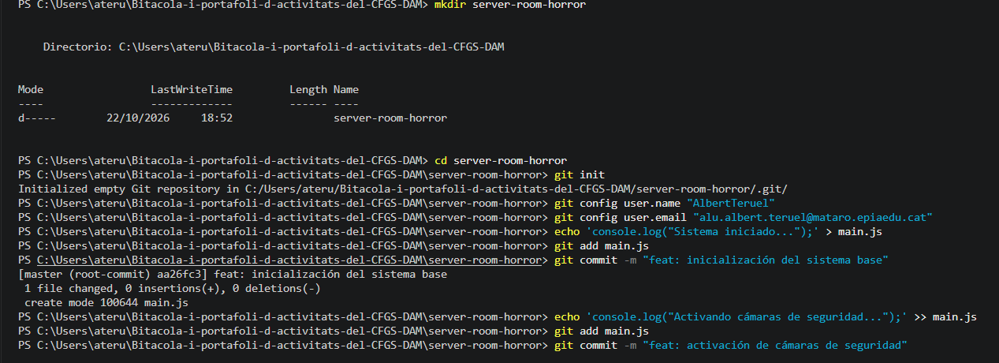

# Bloc 1: Invocació del Repositori i Línia Base

**Acció 3.1 - 3.2: Inicialització i configuració**
He creat el directori, inicialitzat Git i configurat el meu usuari professional.

mkdir server-room-horror
cd server-room-horror
git init
git config user.name ""
git config user.email ""

**Acció 3.3 - 3.4: Creació de la línia base**
He creat `main.js` amb el codi base i realitzat 3 commits per establir la línia temporal estable.

echo 'console.log("Sistema iniciado...");' > main.js
git add main.js
git commit -m "feat: inicialización del sistema base"
echo 'console.log("Activando cámaras de seguridad...");' >> main.js
git add main.js
git commit -m "feat: activación de cámaras de seguridad"
echo 'console.log("Cerrando puertas de acceso...");' >> main.js
git add main.js
git commit -m "feat: cierre de puertas de acceso"

**Acció 3.5: Verificació de l'historial**

git log --oneline

