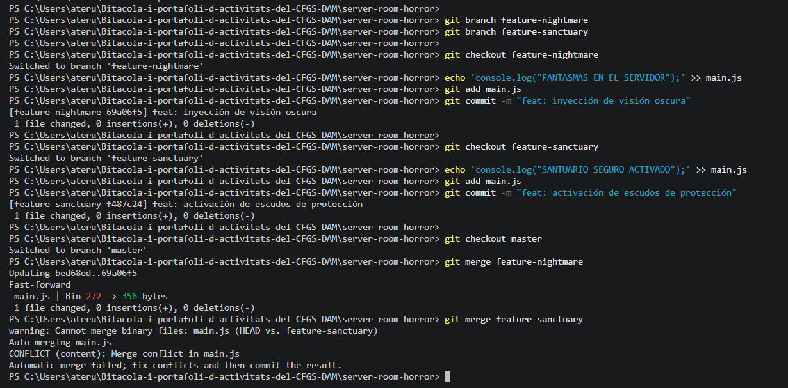

# Bloc 2: Les Branques del Més Enllà i Resolució del Conflicte

**Acció 3.6: Creació de branques**
He creat les branques des del punt actual de `main` perquè ambdues representen futurs divergents a partir de la mateixa línia temporal base.

git branch feature-nightmare
git branch feature-sanctuary

**Acció 3.7 - 3.8: Modificació en paral·lel**
He afegit una línia de codi diferent exactament al mateix lloc (al final del fitxer) a cada branca.

git checkout feature-nightmare
echo 'console.log("FANTASMAS EN EL SERVIDOR");' >> main.js
git add . && git commit -m "feat: inyección de visión oscura"

git checkout feature-sanctuary
echo 'console.log("SANTUARIO SEGURO ACTIVADO");' >> main.js
git add . && git commit -m "feat: activación de escudos de protección"

**Acció 3.9 - 3.10: El ritual de fusió (Resolució de conflictes)**
Al fusionar la segona branca ha donat conflicte. He obert el fitxer, esborrat les marques `<<<<<<<`, `=======` i he deixat la lògica del santuari abans de finalitzar la fusió.

git checkout main
git merge feature-nightmare
git merge feature-sanctuary
# Es resol manualment al fitxer
git add main.js
git commit -m "fix: ritual de fusión, código purificado"

