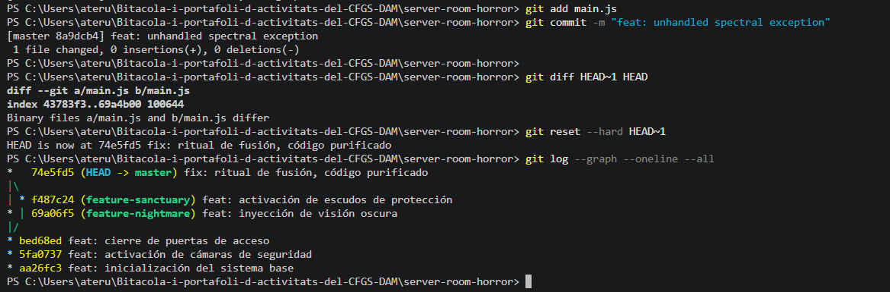

# Bloc 3: Viatge Temporal i Exorcisme del Codi

**Acció 3.11: Commit infectat**
L'esperit crea un commit corrupte a la branca principal.

echo 'throw new Error("Unhandled spectral exception");' >> main.js
git add main.js
git commit -m "feat: unhandled spectral exception"

**Acció 3.12: Inspecció de la diferència espectral**
Mostro exactament quines línies ha introduït aquest codi corrupte.

git diff HEAD~1 HEAD

**Acció 3.13: Reversió temporal (Exorcisme)**
Utilitzo `reset --hard` per destruir els canvis de l'espai de treball i retrocedir un commit enrere en l'historial, eliminant el rastre de l'esperit.

git reset --hard HEAD~1

**Acció 3.14: Topologia Final**
Verifico la línia temporal purificada i les fusions realitzades.

git log --graph --oneline --all

